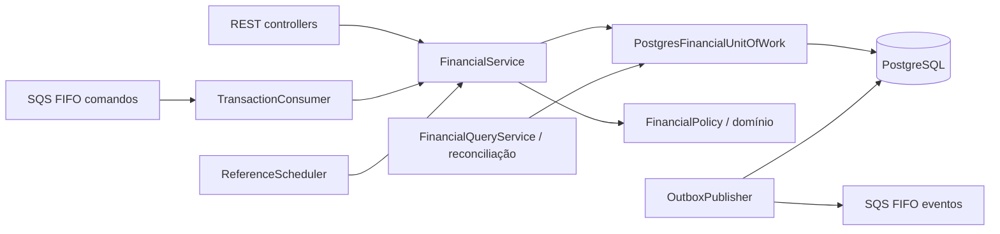
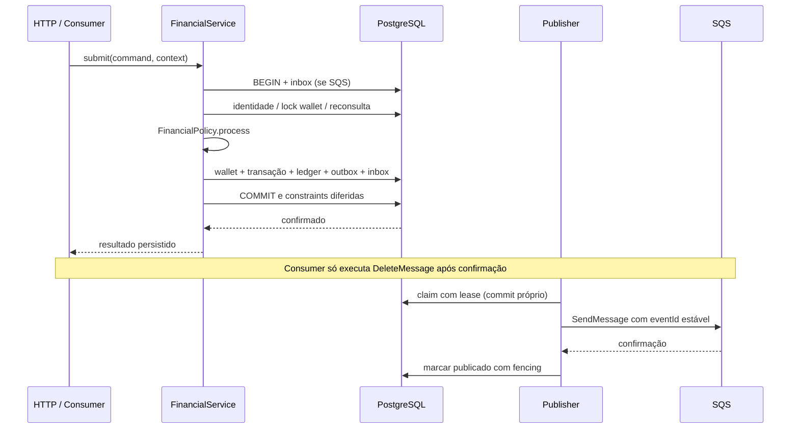

# Arquitetura — Distributed Wagering Processor

Documento do comportamento atual. O enunciado é [docs/CHALLENGE.md](docs/CHALLENGE.md);
a auditoria final e as divergências estão em [FINAL_REVIEW.md](FINAL_REVIEW.md).
As revisões de SQL das etapas 3 e 6 são registros de aprovação preservados em docs/.
A remediação 8.1 mantém schema, privilégios e política financeira; acrescenta a
extensão de identidade, classes de mensageria e overrides transitivos aprovados.

## Módulos e responsabilidades

| Camada | Componentes | Responsabilidade |
|---|---|---|
| Domain | Money, Wallet, WagerTransaction, FinancialPolicy, WalletLedgerEntry | Invariantes, decisões e transições imutáveis |
| Application | FinancialService, FinancialQueryService, reconciliation, portas | Coordenar use cases, hash/snapshots, referências e eventos |
| HTTP | Controllers, DTOs, response mappers, exception filter | Contrato REST e tracing, sem cálculo financeiro ou SQL |
| Persistence | MikroORM, UoW, repositories, mappers, migrations | Locks, ACID, tradução de registros e proteções SQL |
| Messaging | SqsService, TransactionConsumer, OutboxPublisher | Transporte FIFO, ACK, visibilidade, retry/DLQ, publicação |
| Pending reference | ReferenceScheduler e repository | Polling e claim, delegando a decisão ao FinancialService |
| Observability/config | JsonLogger, métricas, loadConfig | Logs/snapshots e configuração validada |

Dependências seguem Interfaces → Application → Domain. Infrastructure implementa
as portas da Application. Domain importa apenas código do domínio e decimal.js;
não importa NestJS, MikroORM, AWS SDK ou serviços externos. Application não importa
infraestrutura. AppModule e entrypoints dos workers compõem os adapters.

MikroORM usa EntitySchema e registros escalares. Os registros ORM não são entidades
de domínio: mappers chamam factories rehydrate. Cada operação tem fork/identity map
próprios, sem contexto global. InboxMessage/OutboxMessage são classes de domínio com
factories, rehydrate, estado imutável e datas defensivas, usadas pelos repositories.
Payloads são cópias JSON profundamente congeladas. Locks e proteção entre processos
continuam no SQL; não foi criado outro protocolo de mensageria.

## Stack e representação financeira

Bun 1.4.4, TypeScript strict, NestJS 11.2.8, MikroORM 6.6.17, PostgreSQL 17.11,
LocalStack 4.12.0 e AWS SDK SQS v3. decimal.js 10.6.0 usa configuração privada, precisão
64 e representação string. Valores externos têm duas casas; não há arredondamento
implícito, expoente, number monetário, NaN ou Infinity. A escala do exercício é dois
para todas as moedas; o modelo preserva moeda e recusa incompatibilidades.

NUMERIC sem typmod evita arredondamento antes do CHECK. O domain SQL protege
não-negatividade, finitude, escala <=2 e limite de 18 inteiros/2 decimais. Mappers
serializam duas casas. Versões usam bigint/string; totais de reconciliação podem
exceder a faixa de uma wallet e usam bigint de centavos. Number é reservado a
contadores, timestamps, paginação, latência e parâmetros operacionais.

Factories/constructors privados encapsulam Money, Wallet, transações e ledger.
Transições retornam novas instâncias; datas são copiadas e snapshots são congelados.
Rehydrate reconstrói estado estrutural sem reaplicar débito/crédito ou transições.

## Unidade transacional e concorrência

FinancialService é o único processador financeiro para API e consumer. O scheduler
usa resolveNextPendingReference, que reaproveita evaluate/persistDecision e a mesma
FinancialPolicy. Não há segundo motor de saldo.

Uma chamada UoW.write usa READ COMMITTED e transação MikroORM. A ordem é inbox,
quando presente, → wallet → transação atual. O lock pessimista da wallet é a unidade
de concorrência. Referências/históricos são lidos por MVCC; examinar referência de
outra wallet não adquire o lock dela. Nenhuma chamada SQS ocorre sob esse lock.

Deadlock/serialização 40P01/40001 repetem a UoW inteira, no máximo três tentativas,
com novo fork e reconsulta. Lock/statement timeout e indisponibilidade retornam
PERSISTENCE_UNAVAILABLE, não rejeição financeira. Erro não classificado após trabalho
concluído pode ser commit incerto: sem compensação ou retry automático. A identidade
persistida/inbox é consultada antes de repetir. Wallets independentes não compartilham
um mutex global. O advisory lock do bootstrap protege somente provisionamento de roles.

## Schema, ledger e papéis de acesso

Quatro migrations versionadas: namespace; modelo financeiro; permissões/diagnóstico
inbox/outbox; deadline/índice de referências. Não há schema synchronization, DDL ou
migration no startup da aplicação. Jobs separados executam bootstrap administrativo
e migration antes de app/workers. A reversão exige banco de teste e opt-in, usa
RESTRICT e recusa remover histórico preenchido. Up/down/up é testado em banco vazio.

wagering_owner e wagering_runtime são grupos NOLOGIN com logins distintos. Runtime
não pode ser superuser, owner ou membro de papéis administrativos; a UoW verifica o
papel efetivo. Seus grants permitem apenas operações necessárias, sem DELETE,
TRUNCATE, DDL, alteração de ledger ou acesso ao histórico de migrations.

CHECKs, índices únicos, FKs, triggers imediatos e diferidos garantem:

- wallet única por player/moeda, saldo não negativo e versão coerente;
- chave global e identidade externa únicas;
- identidade e estados terminais imutáveis;
- ledger append-only, direção/equação e sequência por versão;
- correspondência entre saldo, snapshot e ledger no commit;
- ausência de lançamento para LOSS, rejeição ou transação sem movimento;
- identidade e estados finais de inbox/outbox protegidos.

Abertura positiva cria OPENING/CREDIT na versão 1 no mesmo commit. Abertura zero não
cria transação/ledger, mantém versão 1 e o primeiro movimento passa à versão 2.
REJECTED/LOSS não alteram saldo/versão. Um administrador que pode alterar DDL/triggers
não é coberto por uma promessa de proteção contra administrador malicioso.

## Reversões e compatibilidade

REFUND exige BET; ROLLBACK aceita BET, WIN ou REFUND. Provider, player, wallet, moeda,
rodada e valor integral devem coincidir. Reversão que debitaria sem saldo é rejeitada
com REVERSAL_INSUFFICIENT_FUNDS. REFUND/ROLLBACK ausentes podem aguardar referência.

A política atualmente aprovada internamente consome uma referência ao processar
qualquer REFUND ou ROLLBACK direto; o índice transactions_one_reversal_uq considera
somente reference_transaction_id. Isso preserva a unicidade por tipo, mas rejeita
uma segunda reversão de tipo diferente. Não se apresenta essa exclusão conjunta como
uma exigência literal inequívoca do item 7.4. A manutenção da interpretação foi
aprovada na Etapa 8.1: a restrição implica unicidade por tipo e previne dupla
compensação. O avaliador continua informado sobre a restrição adicional; não se
presume aceite externo. Domínio financeiro e constraints foram preservados.

ROLLBACK de REFUND debita o crédito do reembolso, quando há saldo, e não restaura o
direito de reverter diretamente a BET. Rejeições/falhas não consomem esse direito.
PENDING_REFERENCE expirada é REJECTED/REFERENCE_NOT_FOUND, nunca FAILED por TTL.
FAILED é terminal modelado, persistível e consultável; não existe conversão automática
de toda falha permanente de mensagem em transação financeira FAILED.

## Idempotência e replay

Hash v1: SHA-256 UTF-8 do JSON do array
`[1, providerId, externalTransactionId, walletId, playerId, currency, roundId, gameId, kind, amount, referenceOuNull]`.
A ordem é fixa e os valores monetários são canônicos. O cliente não fornece o hash.
Chave, correlationId, timestamps e envelope de transporte não entram no hash financeiro.

Consulta de identidade antes/depois do lock, UNIQUE global/externo e INSERT ON
CONFLICT DO NOTHING com reconsulta resolvem disputas inclusive entre wallets. A
chave não vira alias: mesma identidade com outra chave é conflito. Replay pendente
não executa transição; terminal retorna o snapshot original de saldo, versão e
instante, sem consultar saldo atual. HTTP deriva código/body do snapshot, alterando
apenas idempotentReplay e headers de tracing da nova requisição.

## Inbox, Outbox e SQS

Inbox usa `(consumerName,messageId)` e hash canônico do envelope. Inbox, transação,
wallet, ledger e eventos pertencem ao mesmo commit SQL. MessageGroupId é SHA-256 de
walletId; IDs de deduplicação são estáveis. FIFO otimiza ordenação, mas a integridade
continua no banco. Heartbeat renova visibilidade; um receive por loop evita ultrapassar
uma mensagem falha dentro de batch da mesma carteira.

Outbox armazena envelopes tipados/versionados de IntegrationEvent abstrata e subclasses
Processed, Rejected, PendingReference e WalletBalanceChanged. LOSS emite Processed,
sem BalanceChanged. Abertura zero não emite efeito financeiro. Replay não cria eventos.
Não há backfill de eventos para operações anteriores à implementação de mensageria.

Claim usa SKIP LOCKED, lease e fencing por owner/attempt. Só o evento pendente mais
antigo da wallet é elegível; wallets diferentes podem publicar em paralelo. O envio
acontece fora da transação do claim. Falha depois do envio permite republicar o mesmo
eventId. Subscriber precisa de deduplicação persistente; a suíte inclui uma projeção
SQL de teste, não um subscriber de produto implantado.

Consumer confirma rejeições de negócio. Erros transitórios recebem retry limitado
com backoff/jitter; inválidos/permanentes/esgotados seguem para DLQ após envio
confirmado, com redrive nativo como fallback de crash. Falha no ACK de operação já
confirmada não a transforma em rejeição financeira. Outbox esgotada permanece no
banco e bloqueia a sequência local até intervenção explícita. Guia: docs/MESSAGING.md.

## Scheduler e recuperação

Deadline imutável, attempts e next_attempt_at são persistidos. O scheduler seleciona
wallet com pendência elegível usando FOR UPDATE OF w SKIP LOCKED; só depois trava a
transação. Claim, avaliação, reagendamento/conclusão e eventos são um commit curto,
sem rede ou espera de referência dentro da transação. Não há lease persistente extra:
rollback libera o claim. Statement/lock/idle-in-transaction timeouts limitam sessões
abandonadas.

Defaults aprovados: TTL 24h, 20 avaliações totais incluindo aceite inicial, base 1s,
teto 300s e equal jitter. Falha SQL não consome orçamento. Deadline vencido prevalece
sobre referência tardia. Uma referência válida na última avaliação pode resolver.
Após resolução, replay continua usando snapshot histórico. Ciclos são limitados por
TTL/orçamento; não há detecção topológica. Upgrade de deadlines exige drenar writers
antigos; backfill de created_at + 24h pode expirar pendências legadas.

SIGTERM/SIGINT param polling e drenam trabalho dentro do prazo; SIGKILL dispensa hooks.
A recuperação depende de rollback, identidades persistidas, redelivery e leases, não
de graceful shutdown. Banco e broker reais são usados nos testes; fronteiras de crash
exatas usam processos independentes e o restart conjunto usa 11 containers reais.

## HTTP, saúde e observabilidade

DTOs explícitos validam whitelist, formatos, Money e referências sem coerção. IDs
Unicode preserváveis em PostgreSQL são aceitos; NUL/surrogates isolados são recusados.
Ledger usa cursor Base64URL versionado/vinculado à wallet, keyset por versão e limite
superior fixo. O cursor não é token de autorização ou assinatura criptográfica.

Liveness não consulta dependências. Readiness valida PostgreSQL, tabelas/colunas
operacionais e configuração das quatro filas. Ele não é auditoria completa de cada
trigger/ACL; essa defesa pertence à UoW e aos testes de schema/permissões. Readiness
503 não implica restart automático de container saudável. Workers principais não
expõem HTTP; o Compose distribuído de teste usa supervisor para startup/heartbeat.

Logs JSON incluem timestamp, nível, serviço, instanceId, operation e IDs/resultados
aplicáveis, sem corpo/query/chave/hash/segredos. Publisher distingue eventId do ID do
SQS. O filtro HTTP sanitiza erros e publica código estável. API/workers emitem métricas
a cada 10s. FinancialMetrics conta transições externas observadas após commit, exclui
OPENING/replay/rollback e observa conflitos/retries/locks. Polling vazio conta em commits,
não em transações processadas. Métricas são voláteis por processo; resposta perdida
pode deixar observação ausente. O ledger, não os contadores, é a fonte de auditoria.

Reconciliação lê em READ ONLY REPEATABLE READ, reconstrói desde zero, verifica contexto,
sequência, equações, direção, snapshots e efeito de cada transação. Divergências têm
issues, log e métrica, sem reparo automático. Totais usam bigint de centavos.

## Identidade externa e limite de confiança

A decisão é não integrar IdP nesta entrega. O desenho futuro usa OIDC/JWKS e resolução
de identidade do provedor antes dos controllers financeiros; health permanece público
e SQS é interno, com validação de domínio. Não há usuários/senhas próprios.

NoopProviderIdentityGuard é registrado em AppModule e aplicado aos controllers
financeiros. canActivate permite acesso, sem autenticar ou inventar claims/provider.
Health permanece sem guard. Essa é a extensão explícita exigida na opção sem IdP,
não uma proteção ativa. O teste de composição substitui a implementação pelo modo
de negação e confere todas as rotas financeiras bloqueadas, mantendo health público.

## Ambiente e trade-offs

Compose principal: volume PostgreSQL persistente, LocalStack local, jobs de acesso/
migration/filas e processos separados. Aplicação final roda como bun, com bind de
host somente loopback. O ambiente principal existente não foi atualizado pelos testes.
Composes de teste usam projetos privados, PostgreSQL tmpfs, nenhuma porta ou volume
principal. Instalação limpa de dependências usa frozen lockfile em Docker; no host
não houve instalação/atualização de ferramentas.

Sem Redis, broker adicional, exporter/dashboard, IdP, double-entry ou abstrações
vazias introduzidas por preferência. Duplicações pequenas de validação HTTP/envelope
pertencem a contratos de transporte diferentes e reutilizam o domínio para invariantes.
As dependências diretas têm uso em fonte/build ou são peers exigidos pelo framework.
Após aprovação explícita, overrides fixam Ajv 8.18.0 e Multer 2.5.0 sem mudar a major
de Nest/MikroORM. Ajv passa a usar fast-uri em vez de uri-js/punycode; demais mudanças
do lockfile se restringem a essa resolução transitiva. Atualizações dos pais devem
reavaliar a necessidade dos overrides e repetir audit/testes.

O resultado funcional da etapa 7 permanece histórico. A auditoria final compara
novas execuções ao enunciado literal e não presume que testes da política interna
provem todas as interpretações do contrato. Matrizes e evidências atuais estão em
docs/stage-81. Os relatórios de stage-8 preservam a auditoria anterior à aprovação.

## Integração das classes Inbox/Outbox — Etapa 8.1

PostgresInboxRepository cria o estado por receive, reidrata registros persistidos e
conclui por markProcessed. A conclusão usa o relógio PostgreSQL e a mesma transação
financeira/lock de inbox, sem movimento fora da UoW. As portas/DTOs externos permanecem.

PostgresOutboxRepository usa enqueue antes de gravar o evento. PostgresOutboxStore
reidrata o estado do claim válido e usa markPublished/scheduleRetry para os parâmetros
do UPDATE. O SELECT prévio é indicativo: o UPDATE mantém owner, attempts, publicação
nula e lease válido como predicados autoritativos, inclusive se o claim mudar entre
as duas consultas. Nenhum lock SQL é mantido durante chamada SQS.

Tentativas continuam sendo incrementadas no claim durável, inclusive em crash. Por
isso scheduleRetry não incrementa novamente. Backoff/jitter, ordem, limite e fencing
permanecem no protocolo existente. As transições imutáveis protegem estado terminal,
identidade, datas e payload; o banco continua sendo a garantia entre instâncias.
